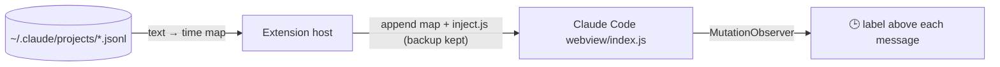

<p align="center"></p>

<h1 align="center">Claude Native Timestamps</h1>

<p align="center"><b>See when every message was sent — right inside the native Claude Code chat in VS Code.</b></p>

<p align="center">
  <a href="https://github.com/meshoklv/claude-native-timestamps/actions/workflows/ci.yml"></a>
  
  
  
  
</p>

<p align="center"><a href="#-quick-start">Quick start</a> · <a href="#-features">Features</a> · <a href="#-how-it-works">How it works</a> · <a href="README.ru.md">Русский</a></p>

---

## Preview

A small pill above each message, in your time zone and your format:

```
🕒 2026-03-06 06:07:09
┌──────────────────────────────────────┐
│ Refactor the parser to stream input  │
└──────────────────────────────────────┘
```

| 🕒 Real times | 🌍 Your zone | 🎨 Your format |
|---|---|---|
| Taken from your local session transcripts, not guessed | System time by default, or any IANA zone / `UTC+9` | `HH:mm · dd.MM.yyyy`, 12h/24h, anything |

## Why

Long Claude Code sessions run for hours, and the official chat shows no time at all. You can't tell what you asked this morning, or how long a task ran. This extension adds the missing label without replacing the chat UI.

> [!WARNING]
> There is no extension API for the Claude Code chat. This project works by **editing a file of the Claude Code extension** (see [How it works](#-how-it-works)). It is fully reversible, but it is a patch, and a Claude Code update can break it until the extension is updated.

## ✨ Features

- 🕒 Adds a time label to every message that has a real timestamp; never invents one
- ⚡ Live messages get the current time as they arrive
- 🌍 Configures time zone: system local (default), `UTC`, IANA name, fixed offset
- 🎨 Configures the format with simple tokens
- 🔁 Re-applies itself after each Claude Code update
- ↩️ One command restores the original file
- 🔒 Local only: no network access, no telemetry, no account changes

## 🚀 Quick start

Requires VS Code 1.85+ (or a compatible fork) and the official **Claude Code** extension (`anthropic.claude-code`).

```bash
git clone https://github.com/meshoklv/claude-native-timestamps && cd claude-native-timestamps
npm ci && npx @vscode/vsce package
code --install-extension claude-native-timestamps-0.1.0.vsix
```

Then **Reload Window**. The patch is applied on startup. A prebuilt `.vsix` is also attached to each CI run.

<details>
<summary>Remote (SSH / WSL / containers)</summary>

Install the extension **in the remote**, next to Claude Code (it runs as a workspace extension). Transcripts are read from the remote home folder, which is where Claude Code writes them.
</details>

## ⚙️ Configuration

| Setting | Default | Description |
|---|---|---|
| `ccNativeTs.timeZone` | `local` | `local`, `UTC`, IANA name (`Europe/Berlin`), or offset (`UTC+9`, `UTC-03:30`) |
| `ccNativeTs.format` | `yyyy-MM-dd HH:mm:ss` | Tokens: `yyyy` `MM` `dd` `HH` `hh` `mm` `ss` `a` |
| `ccNativeTs.transcriptsDir` | _(empty)_ | Transcripts folder; empty = `~/.claude/projects` |
| `ccNativeTs.autoPatch` | `true` | Re-apply on startup |

Changing time zone or format re-applies the patch; reload the window to see it.

Commands: **Claude Timestamps: Apply / Re-apply**, **Claude Timestamps: Remove (restore original)**.

## 🧩 How it works



The chat lives in a sandboxed webview, so nothing outside can draw into it. On startup the extension:

1. finds the installed `anthropic.claude-code` extension and its `webview/index.js`;
2. saves the pristine file next to it as `index.js.cc-ts-backup`;
3. builds a map *normalized message text → earliest timestamp* from your session transcripts (cached by file mtime);
4. appends that map, your settings and `inject.js` to the end of the bundle.

Inside the chat, `inject.js` watches for message blocks and inserts the label. Messages are matched by their text, so history without a transcript match gets no label.

**Changes on disk:** only `webview/index.js` (modified) and `webview/index.js.cc-ts-backup` (new) inside the Claude Code extension folder, plus a small cache in this extension's storage.

**Uninstall / roll back:** run **Remove (restore original)** and reload — or copy `index.js.cc-ts-backup` over `index.js`. Reinstalling or updating Claude Code also gives you a clean file. Disable `autoPatch` before uninstalling this extension so it doesn't re-patch.

**After a Claude Code update:** the update installs a fresh, unpatched copy; on the next startup the patch is re-applied automatically (or run **Apply**). It can stop working if the chat's internal markup changes: the code looks for elements whose class contains `turn_`. Then labels simply don't appear and nothing breaks; open an issue.

**Limitations**

- One label per turn (a question and its answer form one block), showing when the question was sent.
- Needs write access to the Claude Code extension folder.
- Tested with Claude Code 2.1.x on a Linux remote; not yet tested on macOS/Windows desktop.
- Not affiliated with Anthropic.

## 🤝 Contributing

PRs welcome — see [CONTRIBUTING.md](CONTRIBUTING.md). Run `npm test`.

## 📄 License

[MIT](LICENSE)

Made by [@meshoklv](https://github.com/meshoklv)
