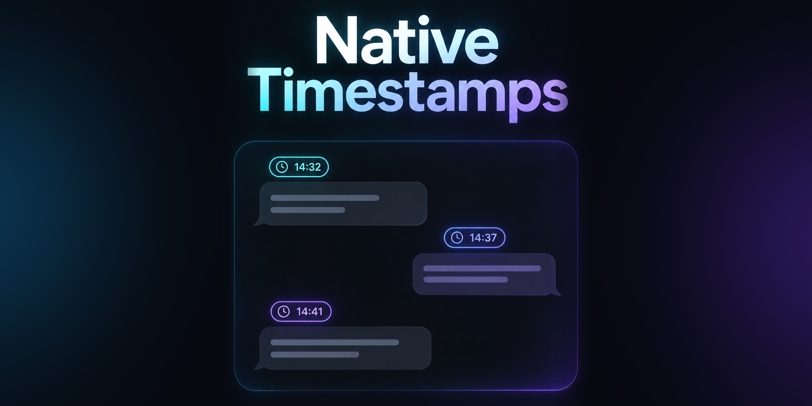
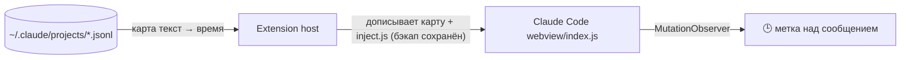

<p align="center"></p>

<h1 align="center">Claude Native Timestamps</h1>

<p align="center"><b>Время каждого сообщения — прямо в родном чате Claude Code в VS Code.</b></p>

<p align="center">
  
  
  
  
</p>

<p align="center"><a href="#-быстрый-старт">Быстрый старт</a> · <a href="#-возможности">Возможности</a> · <a href="#-как-это-работает">Как работает</a> · <a href="README.md">English</a></p>

---

## Как выглядит

Маленькая «пилюля» над каждым сообщением — в вашем часовом поясе и формате:

```
🕒 06.03.2026 06:07:09
┌──────────────────────────────────────┐
│ Перепиши парсер на потоковый ввод    │
└──────────────────────────────────────┘
```

| 🕒 Настоящее время | 🌍 Ваш пояс | 🎨 Ваш формат |
|---|---|---|
| Берётся из локальных транскриптов сессий, без догадок | По умолчанию системное время; любой IANA-пояс или `UTC+9` | `HH:mm · dd.MM.yyyy`, 12/24 часа и т. д. |

## Зачем

Сессии Claude Code идут часами, а в официальном чате времени нет совсем: не понять, что вы просили утром и сколько работала задача. Расширение добавляет недостающую метку, не подменяя интерфейс чата.

> [!WARNING]
> API для чата Claude Code не существует. Проект работает через **правку файла расширения Claude Code** (см. [Как работает](#-как-это-работает)). Это полностью обратимо, но это патч: обновление Claude Code может сломать его до выхода правки.

## ✨ Возможности

- 🕒 Ставит время на каждое сообщение с реальной меткой; не выдумывает
- ⚡ Новые сообщения получают текущее время сразу
- 🌍 Часовой пояс: системный (по умолчанию), `UTC`, IANA-имя, фиксированный сдвиг
- 🎨 Формат задаётся простыми токенами
- 🔁 Само накладывается заново после обновления Claude Code
- ↩️ Одна команда возвращает оригинальный файл
- 🔒 Только локально: без сети, телеметрии и действий с аккаунтом

## 🚀 Быстрый старт

Нужны VS Code 1.85+ (или совместимый форк) и официальное расширение **Claude Code** (`anthropic.claude-code`).

```bash
git clone https://github.com/meshoklv/claude-native-timestamps && cd claude-native-timestamps
npm ci && npx @vscode/vsce package
code --install-extension claude-native-timestamps-0.1.0.vsix
```

Затем **Reload Window**. Патч накладывается при старте. Готовый `.vsix` также прикладывается к каждому прогону CI.

<details>
<summary>Удалённая среда (SSH / WSL / контейнеры)</summary>

Ставьте расширение **на удалённой стороне**, рядом с Claude Code (оно работает как workspace-расширение). Транскрипты читаются из домашней папки там же, где их пишет Claude Code.
</details>

## ⚙️ Настройки

| Параметр | По умолчанию | Описание |
|---|---|---|
| `ccNativeTs.timeZone` | `local` | `local`, `UTC`, IANA-имя (`Europe/Berlin`) или сдвиг (`UTC+9`, `UTC-03:30`) |
| `ccNativeTs.format` | `yyyy-MM-dd HH:mm:ss` | Токены: `yyyy` `MM` `dd` `HH` `hh` `mm` `ss` `a` |
| `ccNativeTs.transcriptsDir` | _(пусто)_ | Папка с транскриптами; пусто = `~/.claude/projects` |
| `ccNativeTs.autoPatch` | `true` | Накладывать при старте |

Смена пояса или формата накладывает патч заново; перезагрузите окно, чтобы увидеть.

Команды: **Claude Timestamps: Apply / Re-apply**, **Claude Timestamps: Remove (restore original)**.

## 🧩 Как это работает



Чат живёт в изолированном webview, снаружи в него не нарисовать. При старте расширение:

1. находит установленное `anthropic.claude-code` и его `webview/index.js`;
2. сохраняет чистый файл рядом как `index.js.cc-ts-backup`;
3. строит карту «нормализованный текст сообщения → самое раннее время» из ваших транскриптов (кэш по mtime);
4. дописывает в конец бандла карту, ваши настройки и `inject.js`.

Внутри чата `inject.js` следит за блоками сообщений и вставляет метку. Сообщения сопоставляются по тексту, поэтому у истории без совпадения в транскриптах метки не будет.

**Что меняется на диске:** только `webview/index.js` (изменён) и `webview/index.js.cc-ts-backup` (новый) в папке расширения Claude Code, плюс небольшой кэш в хранилище этого расширения.

**Откат:** команда **Remove (restore original)** и перезагрузка окна — либо скопировать `index.js.cc-ts-backup` поверх `index.js`. Переустановка или обновление Claude Code тоже даёт чистый файл. Перед удалением расширения выключите `autoPatch`, чтобы оно не наложило патч снова.

**После обновления Claude Code:** обновление ставит свежую неизменённую копию; при следующем старте патч накладывается автоматически (или запустите **Apply**). Он может перестать работать, если изменится внутренняя разметка чата: код ищет элементы с классом, содержащим `turn_`. Тогда меток просто не будет, ничего не сломается; создайте issue.

**Ограничения**

- Одна метка на «ход» (вопрос и ответ — один блок), показывает время отправки вопроса.
- Нужен доступ на запись в папку расширения Claude Code.
- Проверено с Claude Code 2.1.x на Linux remote; на десктопных macOS/Windows пока не проверялось.
- Не связано с Anthropic.

## 🤝 Участие

PR приветствуются — см. [CONTRIBUTING.md](CONTRIBUTING.md). Запускайте `npm test`.

## 📄 Лицензия

[MIT](LICENSE)

Made by [@meshoklv](https://github.com/meshoklv)
